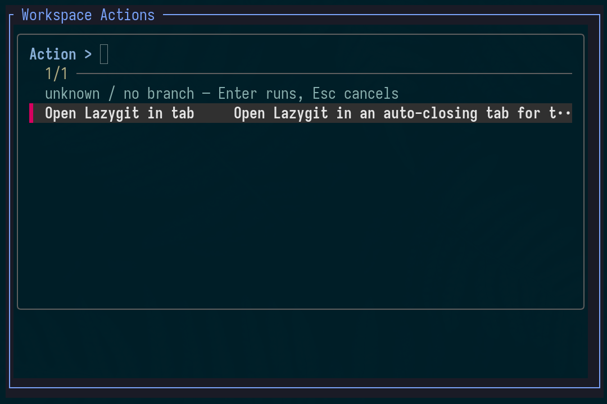

# Herdr Action Launcher

A repository-aware action picker for [Herdr](https://herdr.dev/).

It keeps Herdr's native agent harness intact while providing one fzf action
picker for manual workspace actions configured globally or in a repository's
`.herdr/actions.json` file.



## Features

- one popup picker for the active workspace, repository, or worktree;
- repo-local actions with global defaults and ID-based overrides;
- one-off commands run directly in the picker;
- persistent services in a split pane or dedicated tab;
- dynamic `Stop: ...` actions for persistent services;
- no runtime dependencies beyond Node.js, Herdr, and fzf.

## Install from GitHub

Install the published repository directly into Herdr's managed plugin storage:

```bash
herdr plugin install nnexai/herdr-action-launcher --yes
```

You can pin a branch, tag, or commit with `--ref`:

```bash
herdr plugin install nnexai/herdr-action-launcher --ref main --yes
```

Herdr-managed installs do not require a local checkout. To migrate from a
local development link, unlink it first:

```bash
herdr plugin unlink nnex.action-launcher
herdr plugin install nnexai/herdr-action-launcher --yes
```

Herdr keeps the plugin's config and state directories when reinstalling. To
refresh a GitHub-managed install later, reinstall it:

```bash
herdr plugin uninstall nnex.action-launcher
herdr plugin install nnexai/herdr-action-launcher --ref main --yes
```

For local development instead, use:

```bash
herdr plugin link /path/to/herdr-action-launcher
```

Bind the plugin action in `~/.config/herdr/config.toml`:

```toml
[[keys.command]]
key = "prefix+alt+a"
type = "plugin_action"
command = "nnex.action-launcher.open"
description = "Workspace actions"
```

Then reload Herdr:

```bash
herdr server reload-config
```

The action schema and persistent pane/tab examples are shown below.

## Global actions

Global actions are stored in the plugin config directory:

```bash
herdr plugin config-dir nnex.action-launcher
```

For example, `actions.json` can define Lazygit for every workspace:

```json
{
  "actions": [
    {
      "id": "open-lazygit",
      "title": "Open Lazygit in tab",
      "description": "Open Lazygit in an auto-closing tab for the active workspace.",
      "mode": "tab",
      "entrypoint": "exec",
      "command": ["lazygit"],
      "cwd": "workspace",
      "tabLabel": "lazygit"
    }
  ]
}
```

## Configuration

The launcher merges action files in this order:

1. global: the plugin config directory's `actions.json`;
2. repository: `<repo-root>/.herdr/actions.json`, when the cwd belongs to a Git repository;
3. active checkout/worktree: `<active-checkout>/.herdr/actions.json` (or the active cwd when no worktree is present).

Actions are merged by `id`, so later scopes override an earlier action with the
same name while all other global and repository actions remain visible. This
allows a committed repository action set to provide defaults while an ignored
`.herdr/actions.json` in an active worktree adds or overrides local commands.

```json
{
  "actions": [
    {
      "id": "dev-server",
      "title": "Start dev server",
      "description": "Start the dev server in a dedicated tab.",
      "mode": "tab",
      "entrypoint": "exec",
      "command": ["npm", "run", "dev"],
      "cwd": "worktree",
      "tabLabel": "dev server"
    }
  ]
}
```

Use `mode: "run"` (the default) for one-off commands, `mode: "pane"` for a
persistent split pane, and `mode: "tab"` for a persistent dedicated tab.
Persistent targets receive a dynamic stop action, and closing their Herdr
pane/tab also terminates the process.

For pane and tab actions, `entrypoint` defaults to `"shell"`: the command runs
inside the pane's interactive shell, which remains after the command exits.
Set `entrypoint: "exec"` to replace that shell with the command; Herdr then
removes the pane/tab when the command exits.

The `cwd` field accepts:

- `workspace`: the active Herdr workspace cwd;
- `worktree`: the active checkout/worktree path;
- `repo`: the repository root.

## License

[MIT](LICENSE) © 2026 Konni Hartmann.
